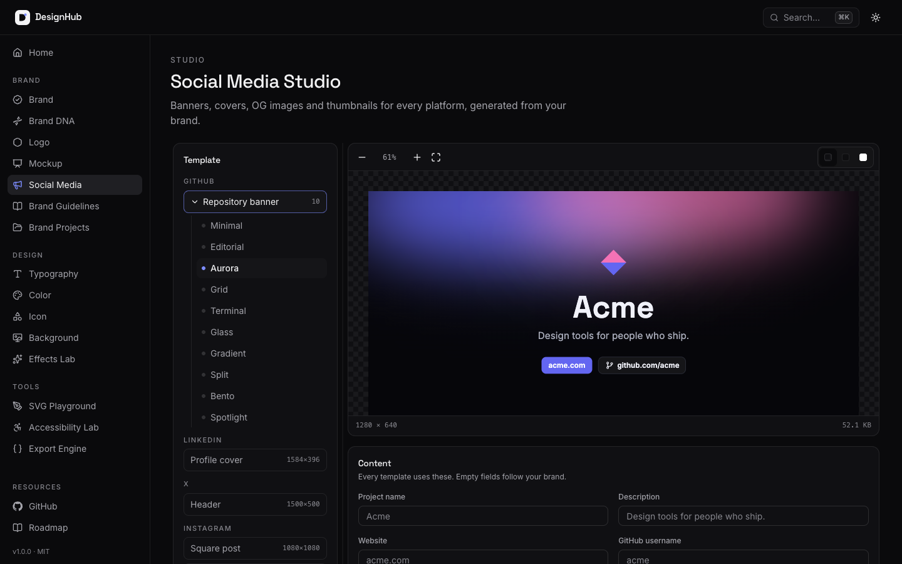

<div align="center">


# DesignHub

**Stop opening 15 design websites. Open one.**

An open-source, local-first design & brand identity toolkit.
Build a brand, then everything it needs: logo variants, mockups, social assets, a brand book and design tokens. Plus typography, color, icons, backgrounds, effects, SVG and accessibility tools, in one fast, keyboard-first workspace.

[Features](#features) · [Screenshots](#screenshots) · [Quick start](#quick-start) · [Roadmap](https://github.com/yakew7/DesignHub/blob/main/ROADMAP.md) · [FAQ](https://github.com/yakew7/DesignHub/blob/main/docs/faq.md) · [Troubleshooting](https://github.com/yakew7/DesignHub/blob/main/docs/troubleshooting.md) ([installed app](https://github.com/yakew7/DesignHub/blob/main/docs/troubleshooting.md#the-installed-app)) · [Glossary](https://github.com/yakew7/DesignHub/blob/main/docs/glossary.md) · [Self-hosting](https://github.com/yakew7/DesignHub/blob/main/docs/self-hosting.md) · [Contributing](https://github.com/yakew7/DesignHub/blob/main/CONTRIBUTING.md). [Translation Guide](docs/translating.md)

[](https://github.com/yakew7/DesignHub/actions/workflows/ci.yml)


</div>

---

## Why DesignHub?

A typical design session bounces between a font site, a palette generator, a contrast checker, an icon library, a mockup generator, a banner resizer, a brand guidelines template and a tokens converter. DesignHub puts all of it in one tab, driven by one brand, and everything you make stays **on your device**.

- **Open source** - MIT licensed. Fork it, extend it, self-host it.
- **One source of truth** - change a color or font once and every logo variant, mockup, social asset, guideline page and token file updates.
- **Local first** - brands, projects, palettes and settings persist in IndexedDB.
- **No login, no backend** - there is no server to send your work to.
- **Offline first** - a studio you have opened once with a connection works without one; icons you have opened are cached for offline use.
- **Calm by default** - a short home page, a short command palette, folded groups and panels, one pane at a time on a phone, a sidebar that collapses to icons, and a Simple mode that shows the common controls first (Advanced shows the rest).
- **Keyboard first** - `⌘K` for everything, `G` + letter to jump, `Space` to shuffle.
- **Production ready** - exports drop straight into CSS, SCSS, Tailwind (v3 and v4), React and Vue, plus PNG, PDF and ZIP asset packs.
- **Dark & light** - tuned themes that follow your system preference.
- **Translatable** - the interface speaks English, Spanish, French and Hindi, including the Effects Lab picker, its accessibility controls and the Accessibility Lab's contrast tools, with more languages welcome.

## Features

| Studio                | What it does                                                          | Exports                                                                                                                                                                                                                                                                                                      |
| --------------------- | --------------------------------------------------------------------- | ------------------------------------------------------------------------------------------------------------------------------------------------------------------------------------------------------------------------------------------------------------------------------------------------------------ |
| **Brand Studio**      | Name, logo, colors with roles, type, radius, spacing, shadow          | Brand JSON · design tokens · DTCG import                                                                                                                                                                                                                                                                     |
| **Brand DNA** (beta)  | Palette, mood, type and personality from up to five images            | Applies to the brand                                                                                                                                                                                                                                                                                         |
| **Logo Studio**       | SVG editor, construction grid, clear space, ten variants, print check | SVG · animated SVG · PNG · PDF · logo pack ZIP                                                                                                                                                                                                                                                               |
| **Mockup Studio**     | Stationery, merch, signage, vehicles, booths, devices and slides      | PNG · WebP (up to 4×) · PDF                                                                                                                                                                                                                                                                                  |
| **Social Media**      | GitHub, LinkedIn, X, YouTube, DEV, Hashnode, Telegram, OG…            | PNG (1× / 2×) · OG meta tags · social ZIP                                                                                                                                                                                                                                                                    |
| **Brand Guidelines**  | A 24-page brand book generated from the brand                         | PDF · PNG per page · static website                                                                                                                                                                                                                                                                          |
| **Brand Projects**    | Local brands with tags, share links, compare and version history      | Project JSON · ZIP of project files                                                                                                                                                                                                                                                                          |
| **Typography Studio** | Google Fonts, variable axes, pairing, fluid type scale, OpenType      | CSS · Fallback CSS · Tailwind · SCSS · React · JSON tokens                                                                                                                                                                                                                                                   |
| **Color Studio**      | Palettes, harmonies, OKLCH, shades 50–950, gradients, WCAG            | CSS variables · Tailwind · JSON tokens · SVG gradient · GIMP · ASE · Sketch · Procreate · Krita · PNG                                                                                                                                                                                                        |
| **Icon Studio**       | 200,000+ Iconify icons, restyling, favicons                           | SVG · React · Vue · Svelte · Angular · Solid · Qwik · Lit · Astro · React Native · CSS · PNG · ICO · favicon ZIP                                                                                                                                                                                             |
| **Background Studio** | 33 generators: waves, mesh, aurora, voronoi, flow field…              | SVG · PNG (1× / 2×) · CSS background                                                                                                                                                                                                                                                                         |
| **Effects Lab**       | Glass, neumorphism, shadows, scrim, card tilt, gradient text, grain…  | CSS · Tailwind classes · Tailwind `@utility` · SCSS · React                                                                                                                                                                                                                                                  |
| **SVG Playground**    | Inspect, edit, optimize, convert, build sprites                       | Optimized SVG · JSX · React · React Native · Vue · Svelte · Angular · Solid · CSS data URI · sprite                                                                                                                                                                                                          |
| **Accessibility Lab** | WCAG contrast, color vision, readability, dyslexia, touch targets     | JSON and Markdown audit report                                                                                                                                                                                                                                                                               |
| **Export Engine**     | One token model from every studio, plus brand assets                  | CSS · SCSS · Sass map · Less · Stylus · Tailwind · JS · YAML · UnoCSS · Panda · Chakra · shadcn · Bootstrap · Style Dictionary · @property · light-dark() · Xcode · Android · React · Vue · Flutter · SwiftUI · Compose · Qt Quick · Godot · Unity USS · Windows Terminal · VS Code · Android · JSON · Figma |

### Brand Studio

- The hub of your identity: name, description, logo (upload an SVG or use the generated mark), colors with primary / secondary / neutral roles, heading and body fonts, radius, spacing and shadow
- Synchronized tokens: the brand store keeps only what is unique to the brand and reads everything else live from Color Studio, Typography Studio, the Export Engine and the Effects Lab, so there is never a second copy
- **Surprise me**: a new palette (locked colors stay), a curated font pairing, radius and shadow in one click, with undo
- **Import tokens**: load a W3C DTCG `tokens.json` (like the Export Engine's) to set colors, fonts, radius and spacing, with undo
- **Import CSS**: paste a stylesheet and take its most used colors and its font families, with a preview and undo
- **Undo and redo** (`⌘Z` / `⌘⇧Z`) step back through brand edits across every studio
- Live preview in light and dark with a UI kit, and a token panel with every format from the Export Engine

### Brand DNA (beta)

- Upload, drop or paste a logo, product shot or moodboard (up to five images, combined by area); get a weighted palette, a mood, a type pairing, a radius and personality words. A flat background (like the white behind a logo) is left out automatically
- Provider architecture: an **on-device** provider (free, private, instant) an **AI (mock)** provider that returns sample data and an **AI (your key)** provider that asks a vision model (the Anthropic Messages API, called with `fetch`, with the model of your choice) to describe the images, and an **AI (OpenAI-compatible)** provider for any chat completions endpoint, including a model server on your own machine such as Ollama (no key needed for `localhost`), all behind one `BrandDnaProvider` interface in `lib/brand-dna`. The AI providers are opt-in: you paste your own key, it stays only in your browser's IndexedDB and is removed with one click, the exact downscaled images, instructions, model and destination host are shown before the first request, any failure falls back to the on-device result, and an end-to-end test proves no request goes to a model host without a key. See the [provider guide](docs/brand-dna-providers.md) to add another implementation.
- Staged loading states, editable results with each color's contrast on white and black, and one-click **Apply to brand** with undo

### Logo Studio

- SVG logo editor: recolor every color, monochrome and inverted modes
- **Construction grid, clear space and safe area** guides
- Responsive variants: full color, monochrome, inverted, horizontal and stacked lockups, wordmark, app icon and a circular avatar for profile pictures, a circular seal with the name set around the mark and a 1200 x 630 social share image, with a minimum-size strip and background tests
- **One-color print check**: the monochrome mark is drawn at its printed width (10 to 120 mm) and measured for the thinnest solid stroke and the thinnest gap, then compared with the line weight your press holds (0.25, 0.5 or 1 pt), with the result in millimetres, points and plain words. Tapering points are not mistaken for thin lines, and nothing leaves your browser
- Each variant as SVG, PNG, WebP or PDF
- **Logo pack**: every variant as SVG, PNG and PDF in one ZIP with usage notes, plus avatar PNGs at 400 and 1024 px
- **Animated SVG**: the logo draws itself in (plays once or loops, and respects reduced motion), for splash screens and READMEs

### Mockup Studio

- Print: **business card, letterhead, envelope, stickers, poster, merch (T-shirt and tote), a coffee cup, a hardcover notebook with the logo debossed and an elastic band, a shopping bag, a phone lock screen, an ID badge on a lanyard, a billboard, a 3 x 3 m trade show booth in perspective and a delivery van with the livery wrapped around the body**
- Devices: a **tablet** in landscape (dashboard) and portrait (mobile layout)
- Screens: **landing page on a laptop, analytics dashboard on a desktop, three-screen mobile app, app store screenshots, a smartwatch, a title and a content slide for presentations (sized from the live type scale) and an email signature**, which also copies as an HTML signature for Gmail, Outlook or Apple Mail
- Drawn as SVG from the live brand, in light or dark, with your fonts embedded so exports match the preview
- High-resolution **PNG and WebP (1-4×) and PDF**

### Social Media Studio

- **GitHub repository banner in 15 styles**: Minimal, Editorial, Aurora, Grid, Terminal, Glass, Gradient, Split, Bento, Spotlight, Classic, Launch, Showcase, Features and Badges
- **LinkedIn** profile and company page covers, **X** header, **Bluesky** banner, **Facebook** page cover, **Discord** server banner, **Twitch** channel banner, **Mastodon** header, **Reddit** community banner, **Tumblr** header, **Dribbble** shot, **Behance** project cover, **Patreon** cover, **Kick** channel banner, **Twitch** offline screen, **LinkedIn** event cover, **Bandcamp** header, **Etsy** shop banner, **Gumroad** profile cover, **Ko-fi** page banner, **Buy Me a Coffee** page cover, **Ghost** publication cover, **Notion** page cover, **Medium** publication banner, **Product Hunt** thumbnail, **Instagram** square post, portrait post, story and story highlight cover, **Pinterest** pin, **Open Graph** (article, product, minimal), **Product Hunt** gallery and **YouTube** channel banner and thumbnail
- Exact platform sizes, a safe-area overlay and the zones covered by avatars and timestamps
- One content panel drives every template: project name, description, website, GitHub username, logo, primary and secondary colors, background style, border radius and padding (empty fields follow the brand)
- Twenty core platforms are listed first; the rest (Kick, Bandcamp, Etsy, Gumroad, Ko-fi, Tumblr, Patreon, Behance, Dribbble and others) are under **More platforms**
- Export PNG, @1x or @2x, WebP, SVG, copy the image to the clipboard, Open Graph meta tags, and **a ZIP of the assets you pick** (the core platforms by default, any template by choice, remembered with the project)
- GitHub banners come with a **README snippet** to paste, with an optional "Banner made with DesignHub" link under the image (never on it). Add the [`made-with-designhub`](https://github.com/topics/made-with-designhub) topic to your repo to be considered for the gallery

### Brand Guidelines

- A complete brand book: **cover, introduction, mission and values, logo usage, co-branding, clear space, minimum size, incorrect usage, color palette, color usage, data visualization, typography, typography usage, spacing and layout, iconography, imagery, illustration, UI components, accessibility, voice & tone, social media and a design token appendix**
- Pages can be switched off; numbering and contents follow. Voice and tone, the mission and up to four values are edited in place
- **Export the book as a PDF** (pdf-lib) with bookmarks and a clickable contents page, any page as PNG, or the whole book as a **static website** ZIP to host anywhere

### Brand Projects

- Keep several brands side by side in IndexedDB; each project is a snapshot of every brand-defining studio
- Create, open, rename, duplicate, delete (with undo) and favorite; last edited and last opened; search, a favorites filter, tags with a tag filter and four sort orders
- **Compare** two projects side by side, and **version history** per project: a version every few minutes of editing and before risky actions like Surprise me or imports, with preview and undoable restore
- **Share a brand as a link**: the brand is compressed into the link itself (no server); opening it asks before adding it as a new project
- The open project **autosaves** while you work anywhere in the app, and in Chromium it can also write each project to a folder you choose (`.designhub.json` files you can keep in Git or a cloud folder)
- **Import and export JSON**, one project or all of them (optionally with version history), validated and sanitized on import, or **export all as a ZIP** with one `.designhub.json` per project, named like the folder autosave names them
- Compare project values in a desktop table or stacked property cards on phones, with highlighted differences and readable status labels

### Typography Studio

- Google Fonts browser with 1,000 families, lazy-loaded previews that download only the glyphs they show
- Search, category filters, variable-only filter, sort by popularity / name / weight count
- Sample texts in English, Spanish, German, Vietnamese, Greek and Cyrillic, plus numbers and punctuation
- A keyboard-friendly font list: arrow keys, Page Up / Down, Home / End, `Enter` to pick and `S` to favorite
- Favorites and recent fonts
- Variable font playground: a slider for every axis (`wght`, `wdth`, `opsz`, `SOFT`, `WONK`, …) plus axis animation
- Weight and italic controls, letter spacing and line height, a weight comparison strip in the specimen view (static faces and variable named instances), and a weight waterfall that shows every weight the font has
- Font pairing engine: 42 curated pairs, rule-based suggestions, random pairing with locks, saved pairs
- Fluid type scale generator (separate mobile and desktop ratios) and a standalone `clamp()` generator
- Responsive preview at any viewport width
- OpenType controls: ligatures, small caps, lining / oldstyle / tabular figures, fractions, slashed zero, stylistic sets
- Local font inspector powered by OpenType.js (your file never leaves the browser)
- Exports: **CSS, Fallback CSS** (size-adjusted system faces), **Tailwind, SCSS, React, JSON tokens** and a Google Fonts embed. See [typography fallbacks](docs/typography-fallbacks.md).

### Color Studio

- Palette generator with locked colors, undo / redo and saved palettes
- Palette library: 48 curated palettes filterable by mood (SaaS, corporate, pastel, playful, neon, retro, earthy, forest, ocean, sunset, luxury, monochrome)
- Harmony modes: analogous, complementary, split-complementary, triadic, tetradic, monochromatic
- OKLCH editor with live gradient sliders and **HEX / RGB / HSL / OKLCH** inputs (accepts any CSS color)
- sRGB and Display P3 gamut indicators
- Shade generator (**50–950**) computed in OKLCH, with hue shift
- Gradient builder: **linear, radial and conic**, draggable stops, OKLCH / OKLab / sRGB interpolation
- **WCAG** contrast checker with AA / AAA results, one-click fixes and a full palette contrast matrix that switches between WCAG 2 ratios and APCA Lc values
- Color blindness preview (protanopia, deuteranopia, tritanopia, achromatopsia)
- Exports: **CSS variables, Tailwind, JSON tokens, SVG gradient**, a **Markdown palette table** (`.md`), a **GIMP / Inkscape palette** (`.gpl`), an **Adobe Swatch Exchange** file (`.ase`), a **Sketch palette**, **Procreate swatches**, a **Krita palette**, a **Paint.NET palette** and a **PNG swatch strip**
- Markdown tables include color names, HEX, OKLCH and the selected notation, with optional **50–950** shade rows. Preview, copy or download them from the Export tab.
- Live UI preview on the Export tab: a card, button, link and input in light and dark, painted from the same semantic roles as the themed exports, with the contrast ratio on each surface

### Icon Studio

- Search 200,000+ open-source icons from 200+ Iconify collections
- Browse by collection, with license information
- Browse by topic before you search: 10 curated packs of 24 icons (UI essentials, arrows, brands, developer, design, commerce, communication, media, files, weather), plus one-click search suggestions
- Restyle: color, stroke width, rounded or sharp corners, rotate, flip, padding and background shapes
- Exports: **SVG, React (TSX), Vue, Svelte, Angular, SolidJS, Qwik, Lit, Astro and React Native components, CSS data URI, PNG (16–1024 px) and ICO**
- Export formats grouped in three tiers like the Export Engine (**Core**: SVG, React, HTML; **Frameworks**: Vue, Svelte, Angular, Solid, Qwik, Lit, Astro, Preact, React Native; **Platforms**: CSS data URI), with a search across all of them; the group that holds the open format stays open
- Favicon generator: `favicon.ico`, `icon.svg`, Apple touch icon, PWA icons, `site.webmanifest` and HTML - zipped

### Export Engine

- One shared design-token model built live from every studio
- Generates **CSS variables, SCSS, a Sass map, Less, Stylus, Tailwind v4 `@theme`, Tailwind v3 config, a JavaScript module, UnoCSS, Panda CSS and Chakra UI v3 themes, a shadcn/ui theme, Figma Variables JSON, a Style Dictionary build, a React Native theme, Bootstrap 5 Sass variables, typed CSS `@property` registrations, a CSS `light-dark()` theme, a Material 3 `themes.xml` for Android, a WinUI / WPF `Theme.xaml`, a .NET MAUI `Colors.xaml`, Mantine, Material UI, Vuetify, Ant Design, Tamagui and Radix Themes themes, a GTK 4 `gtk.css`, Xcode asset catalog color sets, React theme, styled-components / Emotion theme, Vue theme, Flutter `ThemeData`, SwiftUI, Jetpack Compose, a Qt Quick `Theme.qml`, a Godot `theme.tres`, a Unity UI Toolkit `theme.uss`, a Windows Terminal `scheme.json`, a VS Code `brand-color-theme.json`, Android `colors.xml`, JSON and YAML tokens** (W3C DTCG format) and **Tokens Studio for Figma** JSON
- Formats grouped in three tiers (**Core**, **Frameworks**, **Platforms**) with a search across all of them; the least used (GTK 4 CSS and Stylus) are marked deprecated and will be removed in 2.1
- Semantic roles (primary, accent, foreground, background) inferred from your palette
- 8px spacing scale and 12px radius scale, both configurable
- Live preview UI kit, one-click copy, **Download JSON**, all formats as `.zip`, preview PNG and a PDF style guide
- Effect tokens (`--shadow-card`, `--shadow-glow`, `--blur-glass`) that follow Tailwind v4's theme namespaces
- **Brand assets**: Brand JSON, the brand guidelines PDF, the logo pack ZIP and the social asset ZIP, built on demand
- **Assets**: background CSS + SVG, the full `effects.css` bundle, the optimized SVG and the accessibility report - always in sync with their studios

### Background Studio

- Thirty-three procedural generators: **waves, wave lines, blobs, mesh gradients, aurora, noise texture, dots, grid, isometric, low poly, voronoi cells, circuit board, halftone, bokeh, starfield, confetti, spirograph, truchet tiles, memphis shapes, flow field, circle packing, rhombus tessellation, hexagons, sunburst, topographic contours, stripes, plus signs, crosshatch, triangles, grainy gradients and three with a Look control: Concentric (rings, arcs or squares), Woven (checks, plaid or argyle) and Zigzag (zigzag, chevron or squiggle)**. A background saved before they were merged opens as the same look
- Seeded and deterministic - every seed reproduces exactly; **Randomize** (or `Space`) rolls a new one
- Shared controls for colors (or one click to use your Color Studio palette), density, scale, rotation and canvas size (desktop, Full HD, Open Graph, square, story)
- Blobs are smoothed with **Paper.js** (loaded on demand); noise uses SVG `feTurbulence`
- Rotation always covers the canvas edge to edge
- Exports: **SVG, PNG (1× and 2×) and CSS** - native CSS gradients for mesh, dots and grid; an inline SVG data URI for the rest

### Effects Lab

- **Glassmorphism** - blur, saturation, tint, opacity, border and shadow
- **Neumorphism** - depth, softness, intensity, light direction, radius; flat, concave, convex and pressed shapes
- **Shadow generator** - unlimited layers (x, y, blur, spread, color, opacity, inset) plus 15 presets: subtle, smooth, elevated, sharp, inner, hairline, soft card, material, floating, dramatic, brutal, long drop, colored glow, pressed and focus ring
- **Inner shadow** - inset shadows for inputs and pressed states, with Input, Pressed and Deep well presets
- **Long shadow** - the flat-design shadow at any angle, for boxes or text, with an optional fade
- **Gradient text** - text filled with the Color Studio gradient, with an optional animated shift and a solid fallback
- **Skeleton** - the loading placeholder shimmer in the brand's neutrals, static under reduced motion
- **Selection** - `::selection` colors with a 4.5:1 contrast check
- **Button press** - a hover lift and a pressed state with a transform and shadow change, with lift, press depth, duration and easing controls and a reduced-motion fallback that removes the transform
- **Scroll shadow** - edge shadows that appear only while there is more to scroll, in pure CSS
- **Scrollbar** - thumb, hover and track colors, width and radius as `scrollbar-color` and `scrollbar-width` with a `::-webkit-scrollbar` fallback and a 3:1 contrast check
- **Focus ring** - a double `:focus-visible` ring with a built-in WCAG contrast check and a one-click fix
- **Text outline** - outlined text with an optional offset shadow copy and a solid fallback
- **Glow generator** - color, radius and intensity with optional text glow
- **Border generator** - gradient borders with no extra markup, and animated conic borders via `@property` (respects reduced motion)
- **Grain overlay** - fractal-noise texture with scale, frequency, opacity and blend mode
- **Scrim** - a gradient that darkens the bottom or top of an image so text over it stays readable, with strength and height controls and a check of the text color over a white image that also says how deep into the scrim the text stays at 4.5:1
- **Card tilt** - a perspective hover tilt with a moving glare in plain CSS (a short snippet sets the custom properties from the pointer, but the tilt works with no script), static under reduced motion
- **Duotone** - SVG filter that maps photo shadows and highlights to two brand colors, with strength and a before/after photo preview
- Live preview on gradient, photo, light or dark backdrops
- Exports: **CSS, Tailwind arbitrary-property classes, Tailwind v4 `@utility`, SCSS mixins and React style objects**

### SVG Playground

- Upload, **drag & drop** or paste SVG; edit the source live
- Safe preview (rendered as an image, so embedded scripts never run) with zoom, fit and backdrops
- **viewBox editor** and intrinsic size controls, including "make responsive"
- **Path & group inspector**: keyboard-navigable element tree, selection highlight, path command breakdown (via svg-path-parser), bounds
- **Fill & stroke editor** for the selected element or every shape at once
- **Optimization engine** (built on svgson): metadata and editor-data removal, id cleanup, group collapsing, precision control, shortest absolute/relative path data, color shortening, style-to-attribute conversion - scripts and event handlers are always stripped
- **Minify** or **pretty print**, with byte savings
- **Compare optimized SVG**: a draggable before/after divider in the preview, with arrow keys, Shift for larger steps and Home/End for the edges. Both images share zoom and alignment; comparison is available while the source has a valid optimized result.
- Converters: **SVG → JSX, SVG → React component (TypeScript), SVG → React Native** (react-native-svg) and **SVG → Vue**, **SVG → Svelte**, **SVG → Angular** and **SVG → SolidJS**, **SVG → Qwik**, **SVG → Lit** and **SVG → Astro** components, plus a **CSS data URI** that is shorter than base64
- **Sprite generator**: combine many SVGs into one `<symbol>` sprite with namespaced ids and usage snippets
- **Download optimized SVG**

### Accessibility Lab

- **WCAG checker** - body text, links, button labels and non-text UI (1.4.11) with AA / AAA verdicts and one-click fixes, a **focus indicator** check (WCAG 2.4.13) against the page and the focused component, the **worst contrast across the brand gradient** for white, black and the text color, plus an advisory **APCA** (WCAG 3 draft) Lc readout for every pair
- **Vision simulation** - protanopia, deuteranopia, tritanopia, grayscale and low vision, one at a time or side by side, plus _perceived_ contrast under each, and a check that flags palette colors that look alike under color blindness
- **Text spacing** - one switch applies the WCAG 1.4.12 spacing (line height 1.5, paragraph 2x, letter 0.12em, word 0.16em) to the preview and says whether text is clipped; the report lists each value
- **Readability** - font size validator, line-height analysis (WCAG 1.4.12), characters-per-line measured in the real font, Flesch reading score and grade
- **Dyslexia preview** - letter and word spacing, a dyslexia-friendly preset and a letter-scrambling reading simulation
- **Touch targets** - 44px validator (2.5.5 AAA) and the 24px + spacing check (2.5.8 AA), drawn to scale
- Everything updates instantly and exports as a **JSON or Markdown report**

## Screenshots

| Brand Studio                                | Mockup Studio                                  |
| ------------------------------------------- | ---------------------------------------------- |
|  |  |

| Social Media Studio                                 | Brand Guidelines                                     |
| --------------------------------------------------- | ---------------------------------------------------- |
|  |  |

| Logo Studio                               | Brand DNA                                    | Brand Projects                                   |
| ----------------------------------------- | -------------------------------------------- | ------------------------------------------------ |
|  |  |  |

| Home                               | Typography                                            |
| ---------------------------------- | ----------------------------------------------------- |
|  |  |

| Colors                                       | Contrast (light theme)                                 |
| -------------------------------------------- | ------------------------------------------------------ |
|  |  |

| Icons                                      | Export Engine                                 |
| ------------------------------------------ | --------------------------------------------- |
|  |  |

## Quick start

Requirements: **Node.js 22+** and **pnpm 11** (the version is pinned in `package.json`; run `corepack enable` to get it automatically). No API keys are needed (the optional Brand DNA AI provider uses a key you paste in the app).

```bash
git clone https://github.com/yakew7/DesignHub.git
cd DesignHub
pnpm install
pnpm dev
```

Open [http://localhost:3000](http://localhost:3000).

### Command line

The `designhub` CLI (`packages/cli`) builds any Export Engine format from an exported `.designhub.json` project, for CI and scripts, with no browser and no runtime dependencies:

```bash
pnpm --filter designhub build   # bundles packages/cli/dist/designhub.mjs
node packages/cli/dist/designhub.mjs build brand.designhub.json --format css,tailwind-v4 --out tokens/
```

It imports the same generators the app uses, so the files match what the Export Engine downloads, and the output is deterministic. `designhub build -` reads the project from standard input. Run it with `--help` to list every format. See [packages/cli/README.md](packages/cli/README.md) and the [CLI and CI guide](docs/cli.md) for copyable GitHub Actions recipes; once published it runs as `npx designhub build ...`.

### PWA and offline development

Production builds register a service worker that installs only the app shell (about 0.6 MB gzipped) and keeps each studio, its page and its files, the first time you open it online. Google Fonts and Iconify responses are cached at runtime, so a studio that has been visited online can be reopened while offline. A studio you never opened online says so when you are offline.

Installed in Chromium, the app also registers as a handler for `.designhub.json` files (double click one to open the import prompt) and as a share target for project files. The icon menu also jumps straight to Colors, Typography, Brand Projects and the Export Engine. Both file features are handled on the device, validate and sanitize the file like a normal import, and ask before adding anything. If install, file open, share target or a stale offline cache misbehaves, see [The installed app](docs/troubleshooting.md#the-installed-app).

The service worker is generated after `next build` from the current Next.js build ID. Its caches are versioned by that build ID, and old DesignHub caches are removed when a new worker activates.

The development server does not register the service worker. If a service worker from a previous production test is still registered in Chrome:

1. Open DevTools.
2. Go to **Application → Service Workers**.
3. Click **Unregister** for DesignHub.
4. Go to **Application → Storage** and use **Clear site data** if cached build assets also need to be removed.

To test the production PWA locally, run `pnpm build && pnpm start`, then visit the app over `http://localhost`.

### Environment variables

None are required. To set the public URL used for canonical links, the sitemap and social previews, copy the example file:

```bash
cp .env.example .env.local
```

| Variable               | Required | Default                 | Purpose                                     |
| ---------------------- | -------- | ----------------------- | ------------------------------------------- |
| `NEXT_PUBLIC_SITE_URL` | No       | `https://designhub.dev` | Canonical URL, sitemap, robots and OG links |

### Scripts

| Command              | Description                                            |
| -------------------- | ------------------------------------------------------ |
| `pnpm dev`           | Start the development server                           |
| `pnpm build`         | Create a production build                              |
| `pnpm start`         | Serve the production build                             |
| `pnpm lint`          | Run ESLint                                             |
| `pnpm typecheck`     | Run the TypeScript compiler in strict mode             |
| `pnpm test`          | Run the unit tests (Vitest)                            |
| `pnpm format`        | Format with Prettier                                   |
| `pnpm format:check`  | Check formatting (used in CI)                          |
| `pnpm fonts:catalog` | Regenerate the bundled Google Fonts catalog            |
| `pnpm check:dashes`  | Fail if any file contains an em dash                   |
| `pnpm check:unused`  | Fail on unused files, exports or dependencies          |
| `pnpm bundle:size`   | Report each route's first-load JS and check its budget |

The [performance guide](docs/performance.md) explains how to measure bundle size, unused code, Lighthouse scores, long tasks and autosave work, and how to read each result.

DesignHub builds to fully static pages, so you can deploy it to any static or Node host (Vercel, Netlify, Cloudflare Pages, a VPS).

### Continuous integration

GitHub Actions run on every push and pull request with Node 22 and pnpm: `ci.yml` (install, typecheck, unit tests, lint, format check, build), `lint.yml` and `typecheck.yml`. Publishing a GitHub Release runs `release.yml`, which builds the app and attaches the build as an artifact. `em-dash.yml` fails if an em dash appears anywhere in the repository (the project uses normal hyphens and punctuation). `welcome.yml` greets first-time contributors on their first issue or pull request.

## Keyboard shortcuts

The most used shortcuts are below. See [docs/shortcuts.md](docs/shortcuts.md) for the full list, grouped by studio, or press `?` in the app.

| Keys                   | Action                                                                                                                                                                                                                           |
| ---------------------- | -------------------------------------------------------------------------------------------------------------------------------------------------------------------------------------------------------------------------------- |
| `⌘K` / `Ctrl K` or `/` | Command palette: studios, fonts, icons, brand projects, brand downloads and languages                                                                                                                                            |
| `?`                    | Show all shortcuts                                                                                                                                                                                                               |
| `⌥T`                   | Toggle dark / light theme                                                                                                                                                                                                        |
| `G` then a letter      | Go to a studio: `H` Home, `R` Brand, `D` Brand DNA, `L` Logo, `M` Mockups, `O` Social, `U` Guidelines, `P` Projects, `T` Typography, `C` Colors, `I` Icons, `B` Backgrounds, `F` Effects, `S` SVG, `A` Accessibility, `E` Export |
| `F`                    | Focus search (Typography, Icons)                                                                                                                                                                                                 |
| `Space`                | Generate palette (Colors) · random pair (Typography › Pairing)                                                                                                                                                                   |
| `Z` / `⇧Z`             | Undo / redo palette changes (Colors)                                                                                                                                                                                             |
| `⌘Z` / `⌘⇧Z`           | Undo / redo brand changes in any studio (not inside text fields)                                                                                                                                                                 |
| `R` / `⇧R`             | Rotate icon                                                                                                                                                                                                                      |
| `[` / `]`              | Previous / next template (Mockups, Social)                                                                                                                                                                                       |

## Tech stack

| Area          | Choice                                                                                                                                           |
| ------------- | ------------------------------------------------------------------------------------------------------------------------------------------------ |
| Framework     | [Next.js 16](https://nextjs.org) (App Router, static rendering)                                                                                  |
| Language      | TypeScript (strict, no `any`)                                                                                                                    |
| Styling       | [Tailwind CSS v4](https://tailwindcss.com)                                                                                                       |
| UI primitives | [shadcn/ui](https://ui.shadcn.com) on [Radix](https://www.radix-ui.com), [cmdk](https://cmdk.paco.me), [Sonner](https://sonner.emilkowal.ski)    |
| Animation     | [Framer Motion](https://motion.dev)                                                                                                              |
| State         | [Zustand](https://zustand.docs.pmnd.rs)                                                                                                          |
| Storage       | [Dexie](https://dexie.org) (IndexedDB)                                                                                                           |
| Color         | [Color.js](https://colorjs.io)                                                                                                                   |
| Fonts         | Google Fonts + [OpenType.js](https://opentype.js.org)                                                                                            |
| Icons         | [Iconify](https://iconify.design)                                                                                                                |
| SVG           | [svgson](https://github.com/elrumordelaluz/svgson), [svg-path-parser](https://github.com/hughsk/svg-path-parser), [Paper.js](http://paperjs.org) |
| Export        | [html-to-image](https://github.com/bubkoo/html-to-image), [pdf-lib](https://pdf-lib.js.org)                                                      |

## Folder structure

```
DesignHub/
├── app/                    # Routes: (marketing) home, (studio) brand · brand-dna · logo · mockups · social ·
│                           #         guidelines · projects · typography · colors · icons · backgrounds ·
│                           #         effects · svg · accessibility · export
├── components/
│   ├── ui/                 # Design-system primitives (shadcn/ui based)
│   ├── layout/             # App shell, navigation, command palette, providers
│   ├── home/               # Landing page sections
│   ├── brand/              # Brand Studio settings, preview and UI kit
│   ├── brand-dna/          # Brand DNA upload, providers and result editor
│   ├── logo/               # Logo Studio editor, guides, variants and export
│   ├── mockups/            # Mockup Studio
│   ├── social/             # Social Media Studio
│   ├── guidelines/         # Brand Guidelines
│   ├── projects/           # Brand Projects and autosave
│   ├── typography/         # Typography Studio
│   ├── colors/             # Color Studio
│   ├── icons/              # Icon Studio
│   ├── backgrounds/        # Background Studio
│   ├── effects/            # Effects Lab
│   ├── svg/                # SVG Playground
│   ├── accessibility/      # Accessibility Lab
│   ├── canvas/             # Reusable SVG preview canvas
│   └── export/             # Export Engine and shared export UI
├── hooks/                  # Reusable React hooks (hotkeys, catalog, icon data, tokens…)
├── lib/
│   ├── brand/              # Brand tokens, surfaces, generated logo mark, font embedding, Brand JSON
│   ├── brand-dna/          # Provider interface, on-device, mock and AI (your key) providers, palette extraction
│   ├── logo/               # Recolor, guides, variants, logo pack
│   ├── mockups/            # SVG drawing kit and mockup templates
│   ├── social/             # Social templates, safe areas, social pack
│   ├── guidelines/         # Brand book pages and PDF builder
│   ├── projects/           # Snapshots, Dexie repository, import / export
│   ├── export/             # Rasterizer and image-to-PDF
│   ├── color/              # OKLCH math, harmonies, shades, gradients, contrast, vision
│   ├── typography/         # Font catalog, Google Fonts URLs, scales, pairing, exports
│   ├── icons/              # Iconify client, SVG builder, ICO / favicon generation
│   ├── background/         # Seeded PRNG, generators, SVG/CSS background export
│   ├── effects/            # Effect definitions and CSS / Tailwind / SCSS / React writers
│   ├── svg/                # Parser, serializer, optimizer, inspector, JSX / React Native, sprites
│   ├── a11y/               # Contrast pairs, vision, readability and touch-target checks
│   ├── tokens/             # Shared design-token model and format generators
│   ├── db.ts               # Dexie database + Zustand storage adapter
│   └── zip.ts              # Tiny dependency-free ZIP writer
├── packages/cli/           # The designhub command line (pnpm workspace package)
├── store/                  # Zustand stores (persisted to IndexedDB)
├── types/                  # Shared TypeScript types
├── scripts/                # Maintenance scripts (font catalog generator)
├── public/
└── docs/                   # Architecture notes and screenshots
```

Read [docs/architecture.md](docs/architecture.md) for how the pieces fit together and [docs/design-tokens.md](docs/design-tokens.md) for the token format. [docs/glossary.md](docs/glossary.md) defines the terms DesignHub uses. To migrate from 1.0, see [docs/migrating-to-v2.md](docs/migrating-to-v2.md). For what Simple and Advanced mode show in each studio, see [docs/simple-and-advanced.md](docs/simple-and-advanced.md). To add a mockup, follow [docs/mockup-templates.md](docs/mockup-templates.md); for a social template, [docs/social-templates.md](docs/social-templates.md); for a brand book page, [docs/guidelines-pages.md](docs/guidelines-pages.md); for an export format, [docs/export-formats.md](docs/export-formats.md).

## Privacy

DesignHub has no accounts and no backend. Your work (brands, projects, palettes, settings) is stored in your browser's IndexedDB and never leaves your device. The app makes network requests to:

- `fonts.googleapis.com` / `fonts.gstatic.com` - to preview Google Fonts and embed brand fonts in exports
- `api.anthropic.com`, or the endpoint you enter - only if you choose an **AI** Brand DNA provider, paste your own key (or point it at a model server on your machine) and approve what is sent: a small downscaled copy of your images and fixed instructions, never your project
- `api.iconify.design` (with `api.simplesvg.com` and `api.unisvg.com` as fallbacks) - to search and download icons
- [Vercel Web Analytics](https://vercel.com/docs/analytics/privacy-policy) - on the hosted site only, to count page views

Vercel Web Analytics is cookie-free and anonymous. It records which pages are visited, the referrer, and the visitor's country, browser, OS and device type, without identifying individuals or tracking them across sites. It never sees what you create in the app. It only loads in builds deployed on Vercel, so self-hosted copies and local development send nothing. To remove it from your own deployment, delete `<Analytics />` from `app/layout.tsx`.

Exported PNGs, PDFs and generated SVGs carry a small "Made with DesignHub" note in their file metadata (not on the artwork), and the README inside each ZIP credits the project. Your own uploaded logos are never modified.

Uploaded logos and Brand DNA images are processed in the browser and never uploaded (the opt-in AI provider above is the one exception, and it sends only what you reviewed). See [docs/storage.md](docs/storage.md) for everything DesignHub keeps in your browser and how to back it up or reset it. None of these services needs an API key from us; the AI provider uses a key you bring yourself.

## Roadmap

- **1.0.0** - the seventeen studios: Typography, Colors, Icons, Export, Background, Effects, SVG, Accessibility, Brand, Logo, Mockups, Social Media, Brand Guidelines, Brand Projects and Brand DNA ✅
- **1.2.0** - the Icon, SVG, Mockup and Social studios in Spanish, French and Hindi, a folded and lazy Storage panel, studios kept for offline use across updates, a size cap on the runtime cache, and a faster, steadier test suite ✅
- **2.0.0 (next)** - quality and consolidation: fewer, better and fully tested studios, a versioned project file with migrations, every language complete, and no AI unless you bring your own key
- **After 2.0** - Plugin marketplace, desktop app, team collaboration

See [ROADMAP.md](ROADMAP.md) for details.

## Contributing

Contributions of all sizes are welcome - bug reports, docs, new export formats or a whole new studio. Start with [CONTRIBUTING.md](CONTRIBUTING.md), or follow [Your first contribution](docs/first-contribution.md) for a step-by-step walkthrough of one change from fork to merged pull request, and please follow our [Code of Conduct](CODE_OF_CONDUCT.md). Security issues: see [SECURITY.md](SECURITY.md).

## License

[MIT](LICENSE) © DesignHub contributors.

Fonts are served by Google Fonts under their respective open licenses. Icons are provided by Iconify; each collection keeps its own license, which is shown in the Icon Studio.
